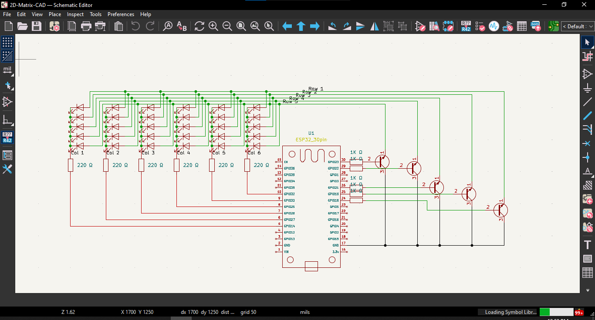
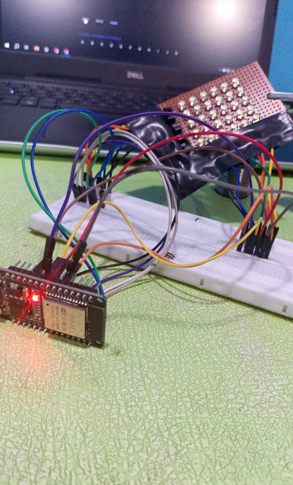

# README
## Summary of the Project
This project is a *2-dimensional LED dot matrix display*. It has 5 horizontal Rows and 6 vertical colums of arranged LEDs[I prefered White LEDs] i.e. **5 x 6 Matrix**. It uses a microcontroller which I am using the *Doit ESP32 Devkit V1* microcontroller to control the rows and colums and using *VScode Editor* to program the microcontroller

## How It Works ?
So basically, the LEDs are controlled by the *microcontroller [ESP32]* which I have programmed to connect to my wifi and broadcast its own website but if it fails to connect to the wifi then it share its own hotspot through which I can connect to the website. The website is basically  a control pannel for the display. I can control each individual LED and display anything. I also added different patterns to the display so it looks fancy/cool.

## Why Make This ?
I am a beginner at electronic and want to learn new things and upgrade my experience. This project was  actually recomended to me by my friend that this project will inhance my working experience with microcontrollers, my way of soldering, and of course improve my experience of electronic.

## BOM

https://github.com/Adam-Primus/2D-Matrix-display/blob/main/BOM.csv

## Schematics

It is not very fancy but it works.

File Link:-
https://github.com/Adam-Primus/2D-Matrix-display/tree/main/2D-Matrix-CAD

## Picture

